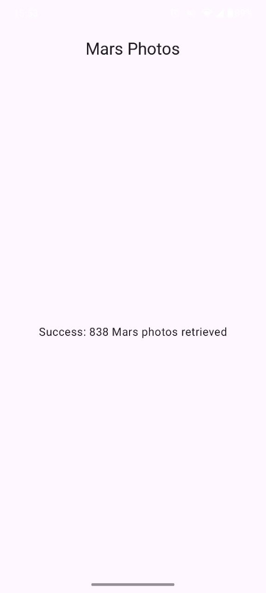
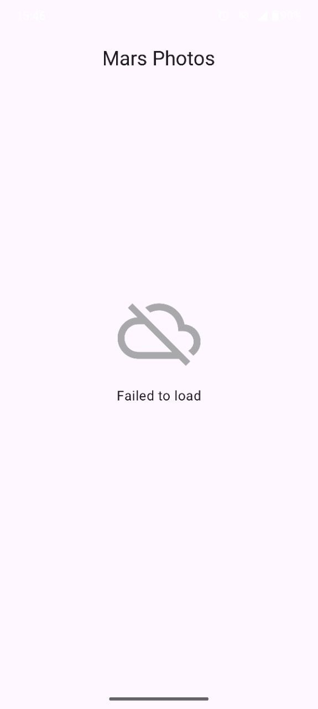

# Mars Photos App (Jetpack Compose)

Este repositório contém a implementação prática desenvolvida ao longo de dois **Codelabs oficiais do Google** no treinamento de Android Basics com Jetpack Compose:

1. [**Rede e Consumo de API em Jetpack Compose**](https://developer.android.com/codelabs/basic-android-kotlin-compose-getting-data-internet?hl=pt-br#0): Implementação de requisições HTTP RESTful, tratamento assíncrono com Coroutines e parsing de dados JSON.
2. [**Carregar e mostrar imagens da Internet**](https://developer.android.com/codelabs/basic-android-kotlin-compose-load-images?hl=pt-br#0): Exibição de imagens em grade reativa, integração da biblioteca Coil (`AsyncImage`) e tratamento de placeholders e erros visuais.

## Tecnologias e Ferramentas Utilizadas

- **Linguagem:** Kotlin
- **UI Framework:** Jetpack Compose (Material Design 3)
- **Consumo de API (Codelab 1):** Retrofit 2 + OkHttp
- **Conversão de Dados (Codelab 1):** `kotlinx.serialization` (JSON Converter)
- **Carregamento de Imagens Assíncrono (Codelab 2):** Coil para Jetpack Compose (`AsyncImage`)
- **Layout de Grade (Codelab 2):** `LazyVerticalGrid` e `Card`
- **Arquitetura:** MVVM (Model-View-ViewModel) com `StateFlow` / UI State
- **Concorrência:** Kotlin Coroutines
- **IDE:** Android Studio
- **Mínimo SDK:** API level 21+

## Conceitos e Aprendizados Práticos

Durante o desenvolvimento deste projeto, os seguintes conceitos foram consolidados:

### Codelab 1: Rede e Consumo de API em Jetpack Compose
- **Comunicação RESTful com Retrofit:** Configuração da interface de API, rotas HTTP (`@GET`) e funções suspendíveis (`suspend`).
- **Desserialização JSON:** Mapeamento de propriedades do JSON retornado da API em data classes Kotlin usando `kotlinx.serialization`.
- **Modelagem de UI State:** Criação da `sealed interface MarsUiState` para gerenciar com segurança os estados da tela (`Success`, `Loading` e `Error`).

### Codelab 2: Carregar e mostrar imagens da Internet
- **Imagens Assíncronas com Coil:** Utilização do composable `AsyncImage` para baixar e armazenar imagens da API em cache.
- **Tratamento de Fallbacks Visuais:** Injeção de `placeholder` (imagem de carregamento) e `error` (ícone de erro de conexão/imagem quebrada) durante o ciclo de vida da requisição.
- **Exibição em Grade Responsiva:** Construção do layout com `LazyVerticalGrid` e `GridCells.Adaptive`, encapsulando as fotos em componentes `Card`.

## Evidências do Projeto (Demonstração Prática)

### 1. Estados da Interface de Usuário

| Grade de Fotos de Marte (Sucesso) | Estado de Carregamento | Estado de Erro de Conexão |
| :---: | :---: | :---: |
|  |  |  |

### 2. Fluxo Interativo e Renderização (GIF)

| Requisição de Rede e Carregamento de Imagens via Coil |
| :---: |
|  |

## Como Executar o Projeto

1. Clone o repositório:
   ```bash
   git clone https://github.com/leticia-farias/compose-training-mars-photos.git
2. Abra o projeto no Android Studio.
3. Aguarde o término da sincronização do Gradle.
4. Garanta que o dispositivo/emulador possua acesso à internet.
5. Execute o aplicativo em um emulador ou dispositivo físico (API 21+).
